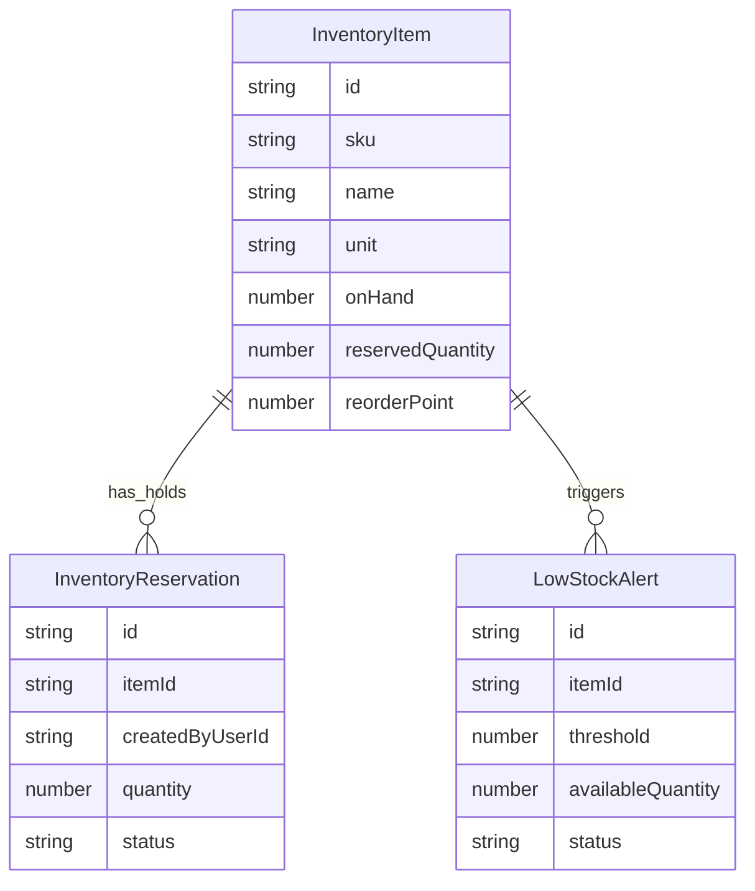

# Domain Model

The app models a single store, so the core entities are inventory items, reservations (holds) and low-stock alerts. All three are plain TypeScript interfaces in `src/domain/inventory.ts`; there is no ORM schema.

## Entity ownership

| Entity | Shape | Owner | Lifecycle |
|---|---|---|---|
| `InventoryItem` | `src/domain/inventory.ts:12-22` | `src/services/inventoryService.ts` | created, metadata patched, `onHand` adjusted; `reservedQuantity` changed only by `reservationService` |
| `InventoryReservation` | `:24-38` | `src/services/reservationService.ts` | `active` → `released` (`ReservationStatus`, `:8`); never deleted |
| `LowStockAlert` | `:40-52` | `src/services/alertService.ts` | `open` ⇄ `cleared` (`AlertStatus`, `:10`); at most one `open` per item by construction |

## Derived vs stored quantities

`availableQuantity` is never stored on the item. It is derived as `onHand - reservedQuantity` by `getAvailableQuantity` (`src/domain/inventory.ts:54-56`), and low stock is `available <= reorderPoint` (`:58-60`) — note *at or below*, while the alert message says "is below its reorder point" (`src/services/alertService.ts:17-19`).

`reservedQuantity`, however, **is** a stored counter. It is not recomputed from the active reservations; `createHold` adds to it (`reservationService.ts:98-100`) and `releaseHold` subtracts (`:151-153`). The two can only stay consistent because both writes happen inside the same `runExclusive` callback as the reservation insert/update. `releaseHold` defends against drift with a guard that refuses to release more than is counted (`:144-149`), but nothing checks the other direction (counter larger than the sum of active holds).

`LowStockAlert.availableQuantity` and `threshold` are snapshots taken on each sync (`alertService.ts:30-38`), so they are historical values, not live ones.

## Invariants and where they are enforced

| Invariant | Enforced at |
|---|---|
| `onHand >= 0` | `adjustStock` (`inventoryService.ts:153-159`); create schema `nonnegative` (`itemSchemas.ts:15`) |
| `onHand >= reservedQuantity` | `adjustStock` (`inventoryService.ts:161-167`); `createHold` via available check (`reservationService.ts:90-96`) |
| hold quantity > 0, safe integer | `createHoldSchema` and `validateCreateHoldInput` (`reservationService.ts:48-50`) |
| released hold cannot be released again | `reservationService.ts:131-133` |
| one open alert per item | `syncLowStockAlertForItem` updates the existing open alert (`alertService.ts:28-39`) |
| SKU unique | **nowhere** — `createItem` and `updateItem` never check for an existing SKU |

## Seed state

`src/data/seed.ts` creates Milk (24 on hand, 0 reserved, reorder 10), Sourdough Bread (8 on hand, 2 reserved, reorder 6), Hand Soap (4 on hand, reorder 5), one active 2-unit bread hold by `clerk-01`, and one open soap alert. Bread's available quantity is `8 - 2 = 6`, which *is* low stock under `<=` (`inventory.ts:59`), yet the seed has no bread alert. The first mutation that touches bread will create one.

## Exercises

**Goal:** prove that duplicate SKUs are accepted.
**Check:** two `POST /api/items` calls with `sku: "MILK-1L"` both return `201`; you cite the absence of any SKU lookup in `inventoryService.createItem` (`:99-115`).

**Goal:** predict the alerts after a manager PATCHes bread with `{"name":"Sourdough Loaf"}`.
**Check:** a new open alert for bread appears with `availableQuantity: 6`, `threshold: 6`, because `updateItem` calls `syncLowStockAlertForItem` (`inventoryService.ts:138`) and there was no open alert to update.
