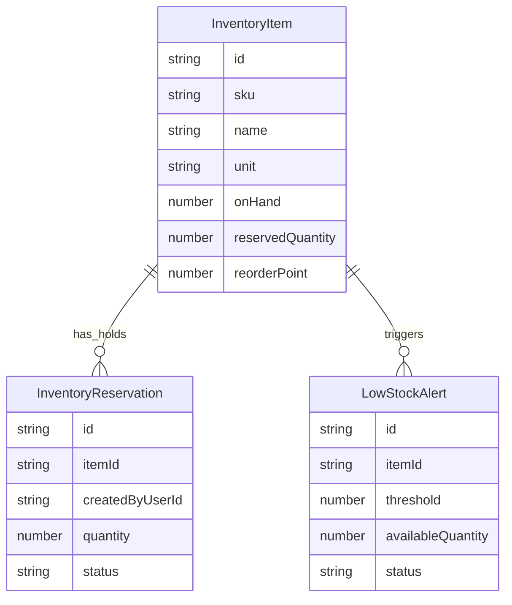

# Domain Model

The app models a single store, so the core entities are inventory items, reservations, and low-stock alerts.

Entity ownership:

- `InventoryItem` is defined in `src/domain/inventory.ts` and its business rules are owned by `src/services/inventoryService.ts`.
- `InventoryReservation` is defined in `src/domain/inventory.ts` and its business rules are owned by `src/services/reservationService.ts`.
- `LowStockAlert` is defined in `src/domain/inventory.ts` and its lifecycle is owned by `src/services/alertService.ts`.

The junior mistake to avoid here is storing `availableQuantity` as an independent field. In this codebase it is always derived from `onHand - reservedQuantity` through `src/domain/inventory.ts`, which is why the service layer can safely recompute it after every mutation.
